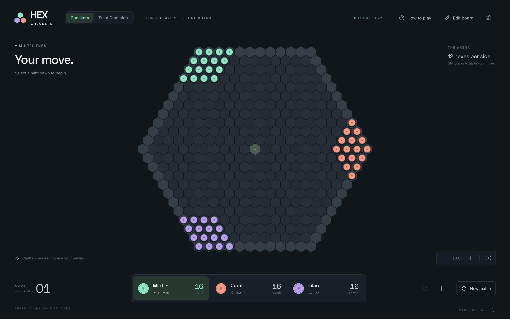
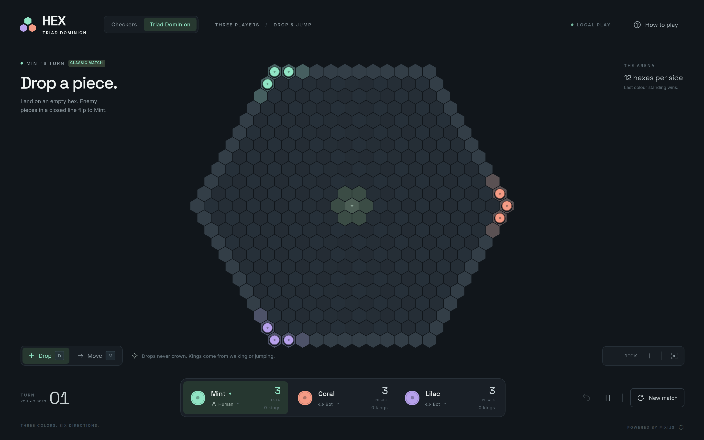

# HEX — Three-player hexagonal checkers & Triad Dominion

Three colours share one 397-hex board. No build step, no accounts, no network
requests, no installs.

**Play online: https://sergutsu.github.io/HexagonalCheckers/**

## Play

Open **`index.html`** in any modern browser (it works from `file://` too), or
serve it locally:

```sh
npm start          # http://localhost:3000
```

WebGL must be enabled.

## One page, two games

Use the **Checkers / Dominion** switch in the header — the board swaps in place,
no reload.

<table>
<tr>
<td></td>
<td></td>
</tr>
<tr>
<td><strong>Checkers.</strong> Move one hex in any of six directions, jump to
capture, and land on the centre or an outer edge to crown a superpawn that
slides and captures along a ray.</td>
<td><strong>Triad Dominion.</strong> Each turn, drop a new piece to flip
trapped enemy lines, or move a piece to capture. Reach the far edge to crown a
king. Last colour standing wins.</td>
</tr>
</table>

Set each side to **Human** or **Bot** with the buttons on the player cards, and
click **How to play** for the full rules of the current mode.

## Handy keys

| Key           | Action                    |
| ------------- | ------------------------- |
| `U`           | Undo                      |
| `Space`       | Pause / resume bots       |
| `H` or `?`    | Rules                     |
| `0`           | Fit the board             |
| `D` / `M`     | Drop / move (Dominion)    |
| `E`           | Board editor (Checkers)   |

Scroll or pinch to zoom, drag to pan. Matches save automatically in the browser.

## Project layout

```
index.html          one page for both modes
styles.css          shared styling
dominion.css        mode switch + Dominion additions
scripts/rules.js    checkers rules, geometry, bot
scripts/app.js      checkers board, controls, persistence
scripts/dominion-rules.js   Dominion rules and bot
scripts/dominion-app.js     Dominion board and controls
scripts/mode.js     switches between the two modes
vendor/pixi.min.js  PixiJS 8.6.6 (MIT)
assets/             bundled fonts and favicon
server.cjs          optional dependency-free static server
tests/              rules, bot, and static-asset tests
```

## Test

```sh
npm test
```

## Publishing to GitHub Pages

`.github/workflows/pages.yml` runs the tests, stages the static files, and
deploys on every push to `main`.

If a deploy fails with **"Resource not accessible by integration"** at the
`configure-pages` step, Pages is not enabled yet: **the automatic `GITHUB_TOKEN`
cannot create a Pages site**. Enable it once by hand:

1. Repository **Settings → Pages**.
2. Under **Build and deployment → Source**, choose **GitHub Actions**.
3. Re-run the workflow.

After that, every push to `main` publishes automatically. (Pages needs a public
repository on a free plan.)
